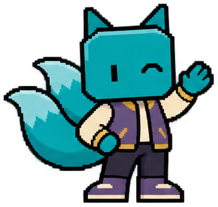
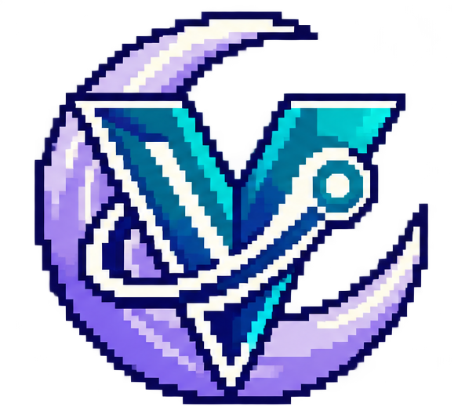
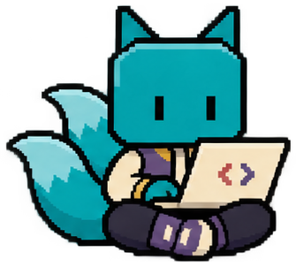

  

  
  
  
  

  

  <i>"La programación se trata de pasión y creatividad. No hay reglas fijas, solo líneas de código que dan vida a tus ideas."</i>

  

## Perfil

<table>
  <tr>
    <td valign="middle">
      Soy estudiante de Ingeniería en Computación en la Universidad Nacional de Ingeniería (UNI), en Nicaragua, y trabajo como desarrollador independiente. Diseño y programo mis propios proyectos de principio a fin, con especial interés en la estética del pixel art y en el rendimiento del software.
    </td>
    <td width="200" align="center" valign="middle">
      
    </td>
  </tr>
</table>

<table>
  <tr>
    <td width="33%" valign="top">
      <b>Videojuegos</b>  
      Diseño y desarrollo de juegos independientes en pixel art, desde la mecánica hasta el apartado visual.
    </td>
    <td width="33%" valign="top">
      <b>Herramientas</b>  
      Utilidades y aplicaciones de escritorio y móvil pensadas para resolver problemas concretos.
    </td>
    <td width="33%" valign="top">
      <b>Ingeniería</b>  
      Bases sólidas en estructuras de datos, algoritmos y programación orientada a objetos.
    </td>
  </tr>
</table>

## Stack Tecnológico

<table>
  <tr>
    <td width="22%"><b>Lenguajes</b></td>
    <td></td>
  </tr>
  <tr>
    <td><b>Web</b></td>
    <td></td>
  </tr>
  <tr>
    <td><b>Motores e IDEs</b></td>
    <td> </td>
  </tr>
  <tr>
    <td><b>Entorno</b></td>
    <td></td>
  </tr>
</table>

## Actividad

  

  

  

  

